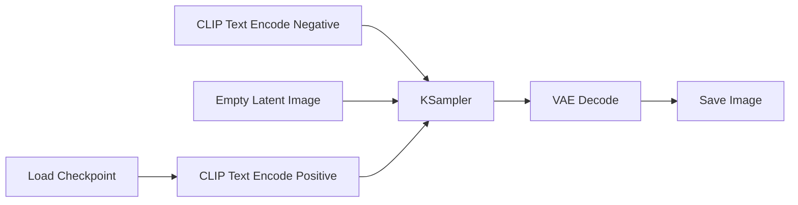

# ComfyUI 全面介绍：安装配置、工作流与实用指南

## 什么是 ComfyUI？

ComfyUI 是一个基于节点的图形化界面，用于构建和运行 Stable Diffusion 工作流。与传统的 WebUI（如 Automatic1111）不同，ComfyUI 采用模块化的节点系统，允许用户通过连接不同的功能模块来创建复杂、可重复的图像生成流程。

### 核心特点
- **节点化工作流**：每个功能（如加载模型、文本编码、采样、图像处理）都是一个独立的节点，通过连接线构建流程
- **高度可定制**：可以保存和分享工作流，便于复现和协作
- **资源效率**：相比 WebUI，ComfyUI 通常更节省显存，运行更稳定
- **扩展性强**：支持自定义节点和插件，社区生态丰富

## 安装与配置

### 系统要求
- **操作系统**：Windows 10/11、Linux、macOS（支持 M1/M2）
- **GPU**：NVIDIA GPU（推荐 RTX 系列，至少 4GB 显存），AMD GPU（通过 ROCm 支持），Apple Silicon
- **内存**：至少 8GB RAM，推荐 16GB 以上
- **存储空间**：至少 10GB 用于安装，另需空间存放模型

### 安装步骤

#### 1. 基础安装（Windows）

**方法一：直接下载便携版（推荐初学者）**
1. 访问 [ComfyUI GitHub Releases](https://github.com/comfyanonymous/ComfyUI/releases)
2. 下载最新版本的 `ComfyUI_windows_portable.zip`
3. 解压到任意目录
4. 运行 `run_nvidia_gpu.bat`（NVIDIA GPU）或 `run_amd_gpu.bat`（AMD GPU）

**方法二：通过 Git 克隆（适合开发者）**
```bash
git clone https://github.com/comfyanonymous/ComfyUI.git
cd ComfyUI
python -m venv venv
venv\Scripts\activate  # Windows
# 或 source venv/bin/activate  # Linux/macOS
pip install torch torchvision torchaudio --index-url https://download.pytorch.org/whl/cu121  # CUDA 12.1
pip install -r requirements.txt
```

#### 2. 模型文件准备
ComfyUI 需要 Stable Diffusion 模型文件，通常放置在 `ComfyUI/models/checkpoints/` 目录下：

- **基础模型**：如 SD 1.5、SDXL、SD 3.0
- **LoRA/LyCORIS**：放置在 `models/loras/`
- **VAE**：放置在 `models/vae/`
- **ControlNet**：放置在 `models/controlnet/`
- **Upscaler**：放置在 `models/upscale_models/`

可以从以下来源下载模型：
- [Hugging Face](https://huggingface.co/models?sort=trending&search=stable+diffusion)
- [Civitai](https://civitai.com/)
- 官方模型仓库

#### 3. 首次运行
1. 启动 ComfyUI（运行对应的批处理文件或执行 `python main.py`）
2. 打开浏览器访问 `http://127.0.0.1:8188`
3. 如果一切正常，将看到空白的节点编辑界面

### 配置优化

#### 性能设置
在 `extra_model_paths.yaml` 中可以配置多个模型路径，便于管理：
```yaml
base_path: D:/AI/Models/  # 模型文件的基础路径
checkpoints: models/checkpoints
loras: models/loras
vae: models/vae
controlnet: models/controlnet
upscale_models: models/upscale_models
```

#### 显存优化
- 启用 `--lowvram` 或 `--medvram` 参数降低显存占用
- 使用 `--cpu` 将部分模块卸载到 CPU（速度较慢）
- 在设置中调整图像生成时的最大分辨率

## 核心概念与界面

### 节点编辑器界面
- **画布**：中间区域，用于放置和连接节点
- **节点菜单**：右键点击画布，选择添加节点
- **工作流管理**：可以加载、保存、导入、导出工作流（JSON 格式）
- **队列系统**：右上角的队列按钮，控制生成任务

### 基础节点类型

#### 1. 加载节点
- **Load Checkpoint**：加载基础模型
- **Load LoRA**：加载 LoRA 模型
- **Load VAE**：加载 VAE 模型
- **Load ControlNet Model**：加载 ControlNet 模型

#### 2. 输入节点
- **CLIP Text Encode**：文本编码（正面/负面提示词）
- **Empty Latent Image**：创建潜在空间图像（设置宽高和批次）
- **Load Image**：加载图像文件

#### 3. 处理节点
- **KSampler**：核心采样器，控制采样方法、步骤数、CFG 等
- **VAE Decode**：将潜在空间解码为图像
- **VAE Encode**：将图像编码为潜在空间

#### 4. 输出节点
- **Save Image**：保存生成的图像
- **Preview Image**：预览图像（不保存）

#### 5. 工具节点
- **Image Scale**：图像缩放
- **Image Composite**：图像合成
- **Mask Composite**：遮罩合成

## 基础工作流示例

### 1. 文生图（Text-to-Image）基础工作流



**步骤**：
1. 添加 `Load Checkpoint` 节点，选择模型
2. 添加两个 `CLIP Text Encode` 节点，分别输入正面和负面提示词
3. 添加 `Empty Latent Image` 节点，设置图像尺寸
4. 添加 `KSampler` 节点，连接所有输入
5. 添加 `VAE Decode` 节点，连接采样器输出
6. 添加 `Save Image` 节点，连接解码器输出

### 2. 图生图（Image-to-Image）工作流

在文生图基础上增加：
1. 使用 `Load Image` 节点加载输入图像
2. 使用 `VAE Encode` 节点将图像编码为潜在空间
3. 将编码后的潜在空间连接到 `KSampler` 的 latent_image 输入

### 3. ControlNet 工作流

1. 加载 ControlNet 模型（`Load ControlNet Model`）
2. 加载控制图像（`Load Image`）
3. 使用 `Apply ControlNet` 节点连接 ControlNet 模型和控制图像
4. 将 ControlNet 输出连接到 `KSampler` 的 control_net 输入

## 高级工作流技巧

### 工作流优化

#### 1. 批量生成
- 在 `Empty Latent Image` 中设置 `batch_size`
- 使用 `Repeat Latent Batch` 节点复制潜在空间
- 结合 `Get Latent Batch` 和 `Set Latent Batch` 处理批次

#### 2. 图像放大
- **使用 Upscaler 模型**：添加 `Load Upscale Model` 和 `Upscale Image` 节点
- **使用潜在空间放大**：在采样后使用 `Latent Upscale` 节点，再进行二次采样
- **使用外部分辨率放大**：如 ESRGAN、Real-ESRGAN 节点

#### 3. 面部修复
- 使用 `FaceDetailer` 节点（需安装对应插件）
- 结合 `Load Face Model` 和 `Apply Face Model` 节点
- 设置面部修复的强度和平滑度

### 插件与扩展

#### 常用插件
1. **ComfyUI Manager**：插件管理器，一键安装其他插件
2. **WAS Node Suite**：提供大量实用节点，如图像处理、文本工具、逻辑控制
3. **Impact Pack**：高级节点包，包含 LoRA 堆叠、图像混合、条件控制等
4. **Efficiency Nodes**：优化节点，提升工作流执行效率
5. **ComfyUI-Impact-Pack**：提供检测器、分割器等计算机视觉节点

#### 插件安装方法
1. 通过 ComfyUI Manager 搜索安装（推荐）
2. 手动安装：将插件仓库克隆到 `ComfyUI/custom_nodes/` 目录，重启 ComfyUI

### 工作流分享与导入

#### 导出工作流
- 点击界面上的 "Save" 按钮，保存为 `.json` 文件
- 工作流文件包含所有节点配置和连接，但不包含模型文件

#### 导入工作流
1. 点击 "Load" 按钮，选择 `.json` 文件
2. 如果缺少节点，ComfyUI 会提示安装相应插件
3. 确保拥有工作流所需的模型文件

#### 在线工作流资源
- [ComfyUI Workflows](https://github.com/comfyanonymous/ComfyUI_examples)
- [Civitai ComfyUI Section](https://civitai.com/tag/comfyui)
- [Reddit r/comfyui](https://www.reddit.com/r/comfyui/)
- [OpenArt ComfyUI Templates](https://openart.ai/workflows)

## 问题排查与优化

### 常见问题

#### 1. 启动失败
- **检查 Python 版本**：需要 Python 3.10 或 3.11
- **检查依赖**：运行 `pip install -r requirements.txt`
- **检查 CUDA/cuDNN**：确保与 PyTorch 版本兼容

#### 2. 模型加载失败
- 检查模型文件路径是否正确
- 确认模型格式（.safetensors 或 .ckpt）
- 检查模型与 ComfyUI 版本兼容性

#### 3. 显存不足
- 使用 `--lowvram` 参数启动
- 减少图像分辨率或批次大小
- 关闭其他占用显存的程序

#### 4. 生成速度慢
- 使用更快的采样器（如 Euler a、DPM++ 2M）
- 减少采样步骤（20-30 步通常足够）
- 启用 xFormers（如果支持）

### 性能优化建议

1. **使用 --xformers 参数**：显著提升注意力机制速度
2. **启用 GPU 半精度**：在设置中启用 FP16 或 BF16
3. **使用 TinyAutoEncoder**：加速 VAE 编码/解码
4. **预加载模型**：将常用模型保持在显存中（如果显存充足）

## 学习资源与进阶指南

### 推荐学习路径

1. **入门阶段**（1-2周）
   - 掌握基础工作流搭建
   - 理解常用节点的功能
   - 学会保存和加载工作流

2. **进阶阶段**（2-4周）
   - 学习复杂工作流（多ControlNet、LoRA混合、图像合成）
   - 掌握插件安装和使用
   - 理解工作流优化技巧

3. **专家阶段**（1个月以上）
   - 创建自定义工作流解决特定问题
   - 开发自定义节点（需要 Python 编程能力）
   - 优化工作流性能和输出质量

### 推荐资源

#### 书籍
- **《玩转ComfyUI：从0开始构建工作流》**（清华大学出版社，2026-03-01）
  - 系统讲解安装配置、界面功能、自定义节点、十大基础工作流
- **《STABLE DIFFUSION与COMFYUI工作流：AI绘画＋AI视频教程》**（2026-01-01）
  - 涵盖环境搭建、模型配置、工作流节点管理、AI绘画/视频实战

#### 在线教程
- [NVIDIA RTX PC 上开始使用视觉生成式 AI（ComfyUI + LTX-2）](https://blogs.nvidia.com.tw/blog/rtx-ai-garage-comfyui-tutorial/)（2026-01）
- [摩尔线程 MTT AIBOOK 本地运行 ComfyUI 指南](https://docs.mthreads.com/playbook/playbook-doc-online/comfyui/)（更新于2026-01-29）
- [SaladCloud 部署 ComfyUI 图像与视频生成服务](https://docs.salad.com/container-engine/how-to-guides/ai-machine-learning/deploy-stable-diffusion-comfy)（最后更新2026-01-08）

#### 社区与支持
- [ComfyUI GitHub](https://github.com/comfyanonymous/ComfyUI)：官方代码库、问题追踪
- [ComfyUI Discord](https://discord.gg/comfyui)：活跃社区，实时帮助
- [ComfyUI Subreddit](https://www.reddit.com/r/comfyui/)：讨论、分享工作流

## 总结

ComfyUI 作为 Stable Diffusion 的节点化界面，提供了无与伦比的灵活性和控制力。虽然学习曲线比传统 WebUI 更陡峭，但一旦掌握，将能构建出复杂、高效、可重复的图像生成流程。

**关键优势**：
- ✅ 模块化设计，工作流可视化
- ✅ 资源利用效率高，适合复杂流程
- ✅ 强大的扩展性和社区支持
- ✅ 工作流可保存、分享、版本控制

**适用场景**：
- 需要复杂、可重复图像生成流程的创作者
- 希望深入理解 Stable Diffusion 工作原理的学习者
- 需要批量处理或自动化生成的任务
- 研究和开发新的图像生成技术

随着 AI 图像生成的快速发展，ComfyUI 正成为专业用户和爱好者的首选工具。通过本指南，希望你能快速上手并发挥 ComfyUI 的强大能力。

---

*最后更新：2026-04-01*
*本笔记持续更新，欢迎补充和修正。*

## 相关笔记
- [[奔向未来/AI学习/AI in ALL]] - AI 综合知识库
- Stable Diffusion 基础 - Stable Diffusion 核心概念
- AI 图像生成工具对比 - 各类 AI 图像生成工具比较

## 标签
#AI #ComfyUI #StableDiffusion #图像生成 #工作流 #教程 #安装配置