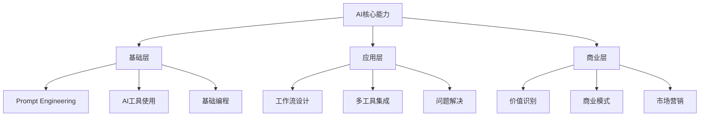

# 普通人AI机会：提升能力与变现途径（2026版）

## 引言：2026年——AI应用黄金期

2026年被广泛认为是**"AI元年"**——AI技术从突破期进入大规模应用的关键节点。随着大模型API成本下降、低代码平台普及、AI工具易用性提升，普通人抓住AI机会的门槛大幅降低。无论你是职场人士、自由职业者、内容创作者还是创业者，AI都能成为你能力提升和收入增长的"杠杆"。

> **核心观点**：AI不是要替代人类，而是要**放大人类能力**。关键在于如何利用AI工具提升效率、创造价值。

## 一、2026年AI机会全景图

### 1.1 五大机会方向

| 机会方向 | 具体说明 | 适合人群 | 变现潜力 |
|---------|---------|---------|---------|
| **AI + 本职工作** | 用AI提升现有岗位效率，成为团队中的"效率提升者" | 所有职场人士 | ⭐⭐⭐⭐ |
| **AI内容创作** | 利用AI辅助写作、视频、设计，提升创作效率和质量 | 内容创作者、自媒体人 | ⭐⭐⭐⭐⭐ |
| **AI工具整合者** | 为企业搭建AI工作流、配置知识库系统 | IT从业者、咨询顾问 | ⭐⭐⭐⭐⭐ |
| **垂直领域AI应用** | 结合行业知识开发差异化AI助手 | 行业专家、专业人士 | ⭐⭐⭐⭐⭐ |
| **AI时代新职业** | Prompt工程师、AI产品经理、AI训练师等 | 技术爱好者、学习者 | ⭐⭐⭐⭐⭐ |

### 1.2 单人AI创业（一人公司）成为主流

2026年，**"单人AI创业"**（One-Person Company, OPC）模式兴起，门槛大幅降低：

- **技术门槛降低**：低代码平台（如Dify、Coze）让非技术背景者也能开发AI应用
- **成本门槛降低**：大模型API免费额度增多，云服务成本下降
- **市场门槛降低**：垂直细分领域仍有大量空白市场等待填补

**典型单人创业路径**：
1. **AI内容生成服务**：为中小商家批量制作短视频、营销文案
2. **垂直AI智能体定制**：为特定行业（法律、教育、电商）构建专属助手
3. **AI赋能专业服务**：将AI作为设计、咨询、翻译等服务的"能力倍增器"

## 二、AI能力提升路径

### 2.1 核心技能树（2026版）

### 2.2 Prompt Engineering学习路径

**Prompt Engineering**已成为AI时代的"元技能"，是所有人学习AI的起点：

#### 阶段一：基础认知（1-2个月）
- **学习目标**：理解大模型原理，掌握基础Prompt设计
- **核心内容**：
  - 主流大模型特点（GPT、Claude、文心一言等）
  - 基础Prompt结构：角色设定、上下文控制、输出格式
  - 简单任务实践：内容生成、摘要、邮件撰写
- **推荐资源**：
  - [IBM《2026年提示工程指南》](https://www.ibm.com/cn-zh/think/prompt-engineering)
  - 腾讯云《从0转型AI全栈：Prompt工程+工具链组合核心技能》

#### 阶段二：进阶技能（2-4个月）
- **学习目标**：掌握复杂Prompt设计，集成工具链
- **核心内容**：
  - 高级技巧：思维链（CoT）、少样本学习、指令微调
  - 工具链入门：LangChain流程编排、RAG实现
  - 前后端基础：FastAPI接口封装、Streamlit界面
- **推荐资源**：
  - 阿里云《黎跃春：2026年不转型AI智能体运用工程师...》
  - 实战项目：私有文档问答助手、个性化内容生成器

#### 阶段三：专项深化（3-6个月）
- **学习目标**：垂直领域深化，系统设计能力
- **核心内容**：
  - 行业专用Prompt设计（金融、医疗、法律等）
  - 系统性能优化：模型量化、提示注入防御
  - 多智能体协作：MetaGPT、AutoGen框架
- **推荐资源**：
  - [清华大学《大模型工程师学习班》](http://xm.sce.tsinghua.edu.cn/info/1054/2071.htm)（2026年4月开课）
  - IBM《Generative AI Engineering with LLMs》专项课程

### 2.3 每日实践建议

1. **把AI当助手，而非玩具**：从实际工作场景开始
   - 整理会议纪要 → 让AI总结要点
   - 写工作方案 → 让AI提供框架
   - 数据分析 → 让AI生成图表解读

2. **建立自己的AI工具箱**：
   - **文本生成**：豆包、通义千问、ChatGPT
   - **图像生成**：Midjourney、Stable Diffusion、[[奔向未来/AI学习/ComfyUI 全面介绍|ComfyUI]]
   - **视频生成**：Sora、Pika、Runway
   - **代码辅助**：GitHub Copilot、Cursor、Codeium

3. **培养AI思维**：
   - 遇到问题先想：AI能帮我做什么？
   - 建立"人机协作"工作流：人类决策 + AI执行
   - 持续迭代优化：基于反馈改进Prompt和工作流

## 三、AI变现途径详解

### 3.1 职场晋升路径

| 岗位类型 | AI赋能方向 | 具体做法 | 预期收益 |
|---------|-----------|---------|---------|
| **运营/市场** | 内容自动化 | 用AI批量生成文案、海报、视频脚本 | 效率提升3-5倍，升职加薪 |
| **设计/创意** | 创意辅助 | AI生成灵感草图，人类优化完善 | 接单量增加，单价提升 |
| **销售/客服** | 客户沟通 | AI辅助话术设计、客户数据分析 | 成交率提升，绩效奖金增加 |
| **管理/行政** | 流程优化 | AI自动化报告、会议管理、任务分配 | 管理效率提升，获得更多资源 |

### 3.2 自由职业变现

#### 途径一：AI内容创作服务
- **短视频代运营**：利用AI工具为商家批量制作产品视频
- **文案代写服务**：为自媒体、企业提供AI优化文案
- **设计外包**：AI生成初稿 + 人工精细化调整
- **市场报价**：单个视频50-200元，文案千字100-300元

#### 途径二：AI技术咨询服务
- **工作流设计**：帮企业搭建AI办公流程
- **工具选型指导**：根据需求推荐合适的AI工具组合
- **培训服务**：为企业员工提供AI使用培训
- **市场报价**：咨询费500-2000元/小时，培训费3000-10000元/天

#### 途径三：AI产品开发
- **小程序/插件开发**：基于AI API开发实用工具
- **SaaS服务**：提供垂直领域的AI解决方案
- **模板销售**：制作并销售AI工作流模板
- **收益模式**：订阅制（月费99-999元）、一次性收费、佣金分成

### 3.3 创业机会

#### 低风险创业模式

1. **AI短剧制作**（已验证成功）
   - **案例**：设计师彭青云用10万成本、3个月制作AI短剧《众神之战》，热度近2000万
   - **关键**：结合AI视频生成 + 传统编剧 + 市场运营
   - **收益**：平台分成、广告植入、IP授权

2. **垂直领域AI助手**
   - **法律AI助手**：合同审查、法律咨询
   - **教育AI助手**：个性化学习规划、答疑辅导
   - **电商AI助手**：选品分析、客服自动化
   - **优势**：行业知识壁垒 + AI技术 = 差异化竞争力

3. **AI工具整合平台**
   - 聚合各类AI工具，提供一站式解决方案
   - 针对特定行业（如跨境电商、新媒体）定制工具包
   - 收益模式：会员费、增值服务、交易佣金

### 3.4 内容创作者的机会

#### 新内容形式
- **AI生成教程**：制作AI工具使用教程，需求巨大
- **AI辅助创作**：用AI提升内容产量和质量
- **AI主题自媒体**：分享AI应用案例、工具评测
- **知识付费**：制作AI课程、工作坊、咨询服务

#### 平台选择
- **视频平台**：B站、抖音、YouTube（AI教程类内容增长迅猛）
- **图文平台**：知乎、小红书、微信公众号（深度解析受欢迎）
- **知识付费**：得到、小鹅通、知识星球（系统化课程需求大）

## 四、成功案例分析

### 4.1 电商商家转型案例
- **背景**：义乌塑料制品商家，传统电商竞争激烈
- **做法**：使用1688"诚信通AI版"进行智能选品、营销文案生成、客户服务
- **结果**：实现年销售额4000万元，登顶品类TOP1
- **启示**：传统行业+AI工具 = 降维打击

### 4.2 一人开发团队案例
- **背景**：杭州小伙张三，非科班出身
- **做法**：用AI辅助5个月上线120多个App
- **结果**：90%项目盈利，单个项目即回本
- **启示**：AI大幅降低开发门槛，个人开发者迎来春天

### 4.3 职业转型案例
- **背景**：前园林设计师陈莺婷
- **做法**：通过开源社区自学AI，成为AI训练营负责人
- **结果**：帮助上万人入门AI，实现职业转型
- **启示**：跨界学习能力在AI时代价值巨大

### 4.4 AI社区支持案例
- **背景**：北京、上海、苏州、武汉等地推出AI社区
- **支持政策**：免租空间、一站式政务、技术赋能、资源对接
- **成果**：孵化数百个AI创业项目，加速技术落地
- **启示**：善用政策资源和社区支持

## 五、学习资源与工具推荐

### 5.1 系统化学习平台

| 平台 | 课程/认证 | 特点 | 适合人群 |
|------|----------|------|---------|
| **清华大学** | 大模型工程师学习班（2026年4月） | 理论+实操，完整技能链 | 系统学习者 |
| **IBM Skills** | Generative AI Engineering专项 | 工程实践导向，2026更新 | 技术工程师 |
| **香港資訊科技學院** | 實踐生成式人工智能證書 | 政府资助，资历架构认证 | 香港从业者 |
| **KodeKloud** | Top 10 AI Courses (2026) | 分角色推荐，实战导向 | 各类工程师 |
| **阿里云开发者社区** | 系列AI文章 | 免费，案例丰富 | 所有学习者 |

### 5.2 必备工具清单

#### 文本与对话
- **豆包**（字节跳动）：中文优化，免费额度充足
- **通义千问**（阿里）：长文本处理优秀
- **文心一言**（百度）：中文理解深入
- **ChatGPT**（OpenAI）：全球标杆，多语言强

#### 图像生成
- **Midjourney**：艺术创作首选
- **Stable Diffusion**：开源可控，自定义强
- **DALL-E 3**：与ChatGPT集成，易用性好
- **ComfyUI**：[[奔向未来/AI学习/ComfyUI 全面介绍|工作流控制强大]]

#### 视频生成
- **Sora**（OpenAI）：效果惊艳，等待开放
- **Pika**：易用性高，社区活跃
- **Runway**：功能全面，生态完整
- **Stable Video Diffusion**：开源可控

#### 开发与集成
- **LangChain**：大模型应用开发框架
- **LlamaIndex**：RAG（检索增强生成）实现
- **Dify**：低代码AI应用开发平台
- **Coze**（字节跳动）：快速搭建AI Bot

### 5.3 社区与资讯

- **国内社区**：
  - WaytoAGI：AI应用实践社区
  - 中关村AI北纬社区：创业孵化社区
  - 知乎AI话题：深度讨论
  - GitHub AI项目：技术前沿

- **资讯平台**：
  - 机器之心：专业AI媒体
  - AI科技评论：深度分析
  - 量子位：行业快讯
  - 少数派：工具评测

## 六、行动指南：从今天开始

### 6.1 30天启动计划

**第一周：认知建立**
- 每天花30分钟使用AI工具处理实际工作
- 注册2-3个主流AI平台，体验不同工具
- 关注3-5个AI领域创作者，学习他们的方法

**第二周：技能入门**
- 系统学习Prompt Engineering基础
- 尝试用AI完成一个实际项目（如周报生成、数据分析）
- 加入一个AI学习社群，交流经验

**第三周：深度实践**
- 选择一个垂直领域深入研究（结合自身专业）
- 搭建一个简单的工作流，解决具体问题
- 输出一篇经验总结，建立个人品牌

**第四周：变现探索**
- 分析自身优势，确定1-2个变现方向
- 制作最小可行产品（MVP）或服务方案
- 开始小范围测试，收集反馈

### 6.2 长期发展策略

1. **T型能力结构**：广博的AI工具知识 + 精深的垂直领域专长
2. **持续学习机制**：每周固定时间学习新技术、新案例
3. **实践导向**：学习后立即应用，建立作品集
4. **网络效应**：积极参与社区，建立人脉资源
5. **迭代优化**：基于市场反馈不断调整方向和方法

### 6.3 心态建设

- **拥抱变化**：AI技术迭代快，保持开放和学习心态
- **长期主义**：不要期待一夜暴富，积累需要时间
- **价值导向**：关注创造真实价值，而非投机
- **人机协作**：发挥人类优势（创意、判断、情感）+ AI优势（效率、规模）

## 七、风险与注意事项

### 7.1 常见误区
- **过度依赖**：AI是工具，决策和判断仍需人类
- **技术崇拜**：关注解决问题，而非追逐最新技术
- **忽视伦理**：注意数据隐私、版权、内容合规
- **缺乏规划**：盲目跟风，没有明确目标和路径

### 7.2 法律与合规
- **版权问题**：AI生成内容的版权归属需明确
- **数据安全**：处理用户数据需遵守相关法规
- **内容审核**：确保AI生成内容符合平台规范
- **合同规范**：提供服务时明确责任和权利

### 7.3 可持续性
- **技术更新**：AI工具快速迭代，需持续学习
- **市场竞争**：蓝海变红海速度快，需建立壁垒
- **收入波动**：自由职业收入不稳定，需多元化
- **职业发展**：关注长期职业规划，避免技能单一

## 结语：你的AI时代，现在开始

2026年，AI不再是遥不可及的未来科技，而是触手可及的生产力工具。无论你的起点如何，都可以通过**学习AI技能 → 解决实际问题 → 创造经济价值**这条路径，在AI时代找到自己的位置。

**关键不是等待完美时机，而是立即开始行动**：
1. 今天就开始使用AI工具
2. 本周内完成第一个AI辅助项目
3. 本月内确定一个变现方向
4. 本季度内实现第一笔AI相关收入

记住：**最大的风险不是尝试后失败，而是从未开始**。AI时代的大门已经打开，关键在于你是否愿意迈出第一步。

---
*最后更新：2026-04-01*
*本笔记将持续更新，欢迎补充案例和经验分享。*

## 相关笔记
- [[奔向未来/AI学习/ComfyUI 全面介绍]] - AI图像生成工具深度指南
- [[奔向未来/AI学习/AI in ALL]] - AI综合知识库
- Prompt Engineering 完全指南 - Prompt技巧详细教程

## 标签
#AI #机会 #变现 #能力提升 #创业 #学习 #PromptEngineering #AI工具 #自由职业 #内容创作