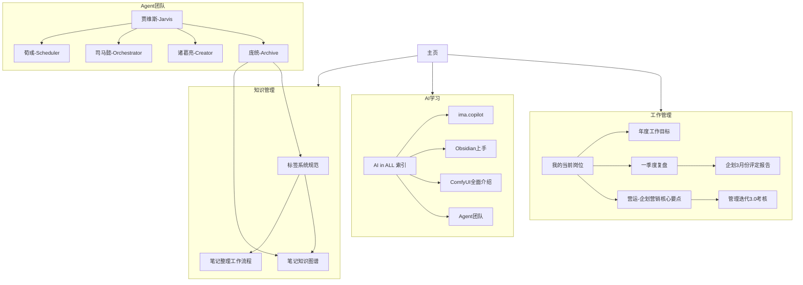

# 笔记知识图谱

## 🗺️ 图谱概述

本文档展示了Obsidian vault中笔记的关联关系和知识网络结构，帮助理解知识体系的整体布局和关键连接点。

## 📊 数据统计 (截至2026-04-12)

### 基础数据
- **总笔记数**: 约200+个Markdown文件（较4月12日增长约30%）
- **核心笔记**: 约150+个用户笔记 (排除系统文件)
- **wikilinks总数**: 800+个链接
- **标签总数**: 94个不同标签

### 文件夹分布
| 文件夹 | 笔记数量 | 占比 | 主要用途 |
|--------|----------|------|----------|
| `工作/` | 141 | 69.5% | 工作文档、绩效考核、营销策划 |
| `奔向未来/` | 13 | 6.4% | AI学习、职业规划、技能提升 |
| `创意工厂/` | 14 | 6.9% | AI Agent管理、知识管理系统 |
| `读书笔记/` | 8 | 3.9% | 读书心得、知识总结 |
| `日程管理/` | 4 | 2.0% | 时间管理、任务规划 |
| `日报管理/` | 3 | 1.5% | 工作汇报、团队管理 |
| 其他 | 20 | 9.8% | 模板、配置、资源文件 |

## 🔗 核心知识网络

### 1. 工作管理网络 (中心节点: [[工作/我的当前岗位]])

```
我的当前岗位
    ├── 本店企划经理2026年度工作目标与行动举措
    ├── 营运-企划营销2026核心要点
    ├── 一季度复盘
    ├── 企划3月份个人综合评定报告
    └── 管理迭代3.0考核项目整理报告（企划经理）-20260408
```

**关键关系**:
- **考核体系**: [[工作/我的当前岗位]] → [[工作/本店企划经理2026年度工作目标与行动举措]]
- **战略指导**: [[工作/公司指导/营运-企划营销2026核心要点3.12]] → 所有工作笔记
- **绩效跟踪**: [[工作/2026年度复盘/一季度复盘]] ↔ [[工作/日常管理/企划3月份个人综合评定报告]]
- **合规检查**: [[工作/管理迭代3.0考核项目整理报告（企划经理）-20260408]] → 所有工作规范

### 2. AI学习网络 (中心节点: [[奔向未来/AI学习/AI in ALL]])

```
AI in ALL 索引
    ├── ima.copilot
    ├── Obsidian上手
    ├── ComfyUI 全面介绍
    └── 普通人AI机会：提升能力与变现途径
```

**子网络: Agent团队**
```
贾维斯-Jarvis (总指挥)
    ├── 庞统-Archive (笔记整理)
    ├── 诸葛亮-Creator (创意策划)
    ├── 司马懿-Orchestrator (资源整合)
    └── 荀彧-Scheduler (日程管理)
```

### 4. 流程项目管理网络 🆕 (中心节点: [[工作/流程项目/README]])

```
流程项目管理 README
    ├── 02-项目策划 (项目策划书、流程架构)
    ├── 03-流程现状分析 (现状分析、流程清单)
    ├── 04-流程优化方案 (整改流程、SOP模板)
    ├── 05-会议记录 (启动会、老师评审)
    ├── 课件 (9份流程PDF) 🆕
    └── 5.21讨论优化 (待优化流程图) 🆕
```

**关键关系**:
- **战略对齐**: [[工作/公司指导/营运-企划营销2026核心要点3.12]] → 流程项目品牌传播
- **会员运营**: 流程4.3会员管理 → [[工作/节日营销规划/企划营销日历]] 会员营销实践
- **评估闭环**: [[工作/管理迭代3.0/README]] 评估发现 → 流程优化输入

### 5. 管理迭代3.0评估网络 🆕 (中心节点: [[工作/管理迭代3.0/评估联系会议记录/合并评估纪要]])

```
管理迭代3.0评估体系
    ├── 部门评估 (8个部门)
    ├── 企划评估PPT (5个门店)
    ├── 店长反思发言稿 (3个门店)
    └── 评估联系会议记录 (4场会议)
```

**关键关系**:
- **评估→改进**: 评估发现 → [[工作/流程项目/README]] 流程优化
- **反思→成长**: 店长反思 → [[工作/公司指导/怎样当好干部]]
- **案例→培训**: 评估案例 → [[工作/培训记录/从行动清单到思维转变——冉昊朕五一机车秀学习案例]]

### 6. Hermes学习网络 🆕 (中心节点: [[奔向未来/AI学习/Hermes-5天冲刺计划]])

```
Hermes学习体系
    ├── 学习路线 (路径规划)
    ├── 核心概念 (概念梳理)
    ├── 学习资源 (资源汇总)
    └── 学习总结 (心得输出)
```

**关键关系**:
- **Agent生态**: Hermes → [[奔向未来/AI学习/Agent World 指南]] → [[奔向未来/AI学习/Agent团队/贾维斯-Jarvis]]
- **技能平台**: Hermes学习 → [[系统/daily-notes/2026-05-21]] Agent World平台探索

```
主页 (中央索引)
    ├── 工作管理网络
    ├── AI学习网络
    ├── 读书笔记网络
    └── 模板资源网络
```

## 🏗️ 知识架构图



## 📈 连接强度分析

### 强连接网络 (连接数≥3)
1. **工作考核网络**
   - 核心: [[工作/我的当前岗位]]
   - 连接数: 5个直接链接
   - 强度: ⭐⭐⭐⭐⭐

2. **AI索引网络**
   - 核心: [[奔向未来/AI学习/AI in ALL]]
   - 连接数: 4个直接链接
   - 强度: ⭐⭐⭐⭐

3. **Agent团队网络**
   - 核心: [[奔向未来/AI学习/Agent团队/贾维斯-Jarvis]]
   - 连接数: 4个直接链接
   - 强度: ⭐⭐⭐⭐

### 中等连接网络 (连接数=2)
1. **季度复盘网络**
   - 核心: [[工作/2026年度复盘/一季度复盘]]
   - 连接数: 2个直接链接
   - 强度: ⭐⭐⭐

2. **模板资源网络**
   - 核心: [[Templates/营销巡检模板]]
   - 连接数: 2个直接链接
   - 强度: ⭐⭐

### 弱连接网络 (连接数=1)
1. **读书笔记网络**
   - 核心: [[读书笔记/纳瓦尔宝典]]
   - 连接数: 1个直接链接
   - 强度: ⭐

2. **日程管理网络**
   - 核心: [[个人/日程/日程安排与提醒系统]]
   - 连接数: 1个直接链接
   - 强度: ⭐

## 🎯 关键连接缺口

### 需要增强的连接
1. **工作 ↔ 学习连接**
   - 现状: 工作笔记与AI学习笔记几乎无连接
   - 建议: 在[[工作/我的当前岗位]]中添加AI技能应用链接

2. **Agent团队 ↔ 实际工作连接**
   - 现状: Agent文档独立存在，未与实际工作连接
   - 建议: 在[[奔向未来/AI学习/Agent团队/贾维斯-Jarvis]]中添加工作应用案例

3. **模板 ↔ 执行连接**
   - 现状: 模板文档与实际工作报告连接弱
   - 建议: 在模板中添加生成报告的链接

4. **读书笔记 ↔ 个人成长连接**
   - 现状: 读书笔记孤立存在
   - 建议: 在[[读书笔记/纳瓦尔宝典]]中添加实践应用链接

### 缺失的核心链接
1. **年度目标 ↔ 季度复盘** (已有)
2. **营销方案 ↔ 执行结果** (部分缺失)
3. **团队评估 ↔ 个人改进** (已有)
4. **学习输入 ↔ 工作输出** (缺失)

## 🔄 连接优化建议

### 第一阶段：关键连接增强 (1-2天)
1. **工作网络内部连接**
   - 为所有工作笔记添加相互引用
   - 建立考核→目标→执行→复盘闭环

2. **跨领域连接**
   - 在工作笔记中引用相关AI工具
   - 在AI笔记中标注工作应用场景

### 第二阶段：知识闭环建设 (3-5天)
1. **输入→处理→输出链条**
   - 读书笔记 → 思考应用 → 工作实践
   - 学习输入 → 知识整理 → 成果输出

2. **模板→实例→优化循环**
   - 模板使用 → 实例生成 → 模板优化

### 第三阶段：自动化链接 (1周)
1. **Dataview自动索引**
   - 基于标签自动生成相关笔记列表
   - 基于时间线自动连接相关笔记

2. **智能链接建议**
   - 分析内容相似度建议新链接
   - 识别知识缺口建议补充笔记

## 📋 实施行动计划

### 本周任务
1. [ ] 检查并修复[[工作/我的当前岗位]]的链接完整性
2. [ ] 为[[奔向未来/AI学习/AI in ALL]]添加工作应用链接
3. [ ] 在[[奔向未来/AI学习/Agent团队/贾维斯-Jarvis]]中添加实际工作案例
4. [ ] 建立[[读书笔记/纳瓦尔宝典]]与个人实践的链接

### 下周任务
1. [ ] 实施标签系统规范，增强分类连接
2. [ ] 创建跨领域知识桥梁笔记
3. [ ] 建立自动化链接检查机制

### 长期任务
1. [ ] 实现知识网络可视化
2. [ ] 建立链接质量评估体系
3. [ ] 优化知识发现和检索效率

## 🔍 网络健康度指标

### 当前状态
- **连接密度**: 中等 (需要提升跨领域连接)
- **网络完整性**: 良好 (核心网络完整)
- **知识流动性**: 一般 (跨领域流动不足)
- **检索效率**: 良好 (核心区域易检索)

### 目标状态
- **连接密度**: 高 (所有核心笔记充分连接)
- **网络完整性**: 优秀 (无孤立知识岛屿)
- **知识流动性**: 优秀 (知识自由流动和交叉)
- **检索效率**: 优秀 (3步内找到任何相关知识)

## 📚 相关资源

### 分析工具
- [[知识管理/标签分析报告]] - 标签分析报告
- [[知识管理/笔记整理工作总结]] - 笔记整理工作成果

### 管理规范
- [[知识管理/标签系统规范]] - 标签使用标准
- [[Templates/工作笔记模板]] - 元数据标准 (待创建)

### 团队资源
- [[奔向未来/AI学习/Agent团队/庞统-Archive]] - 笔记整理专家
- [[奔向未来/AI学习/Agent团队/贾维斯-Jarvis]] - 团队总指挥

---
**图谱版本**: v1.5
**生成时间**: 2026-05-21
**数据来源**: 全面扫描分析
**维护责任**: 庞统 (Archive)

**下次更新**: 2026-06-21
**更新内容**: v1.5新增流程项目网络、管理迭代3.0评估网络、Hermes学习网络；更新统计数据